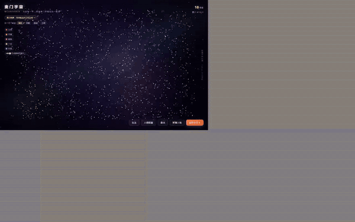
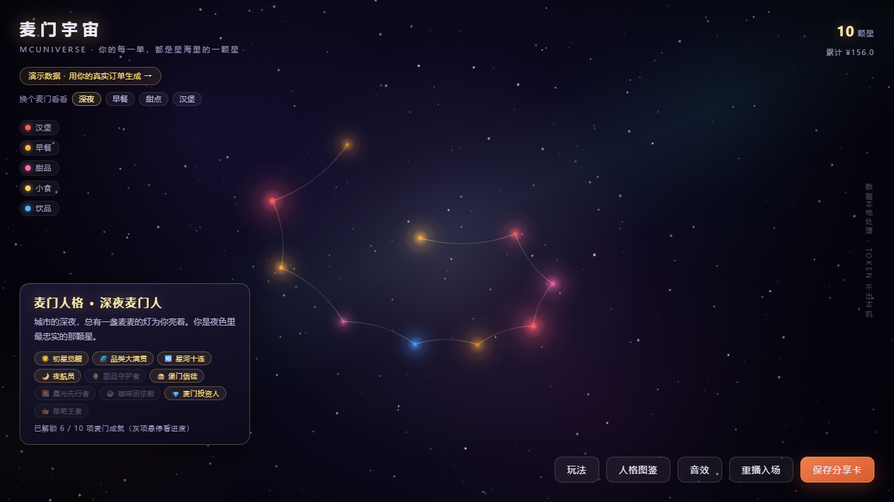
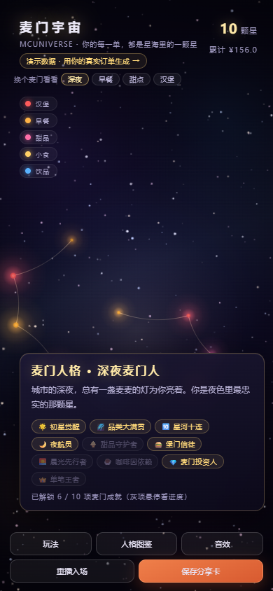
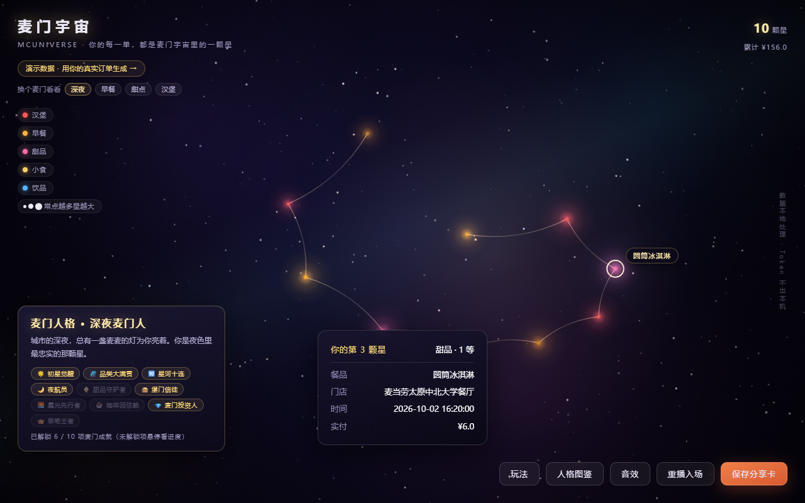
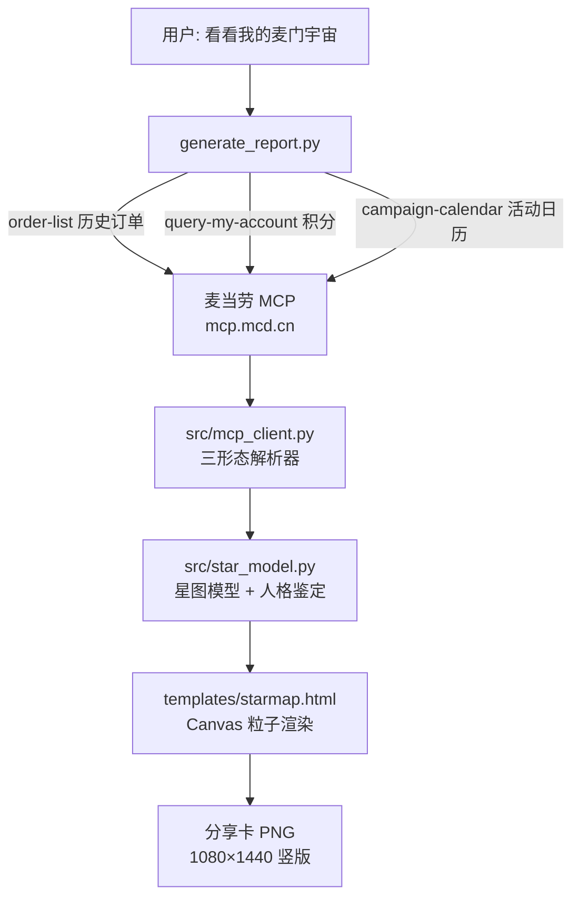

# 麦门宇宙 McUniverse

> 你的每一单，都是麦门宇宙里的一颗星。

基于麦当劳中国官方 MCP 开发的 Skill：拉取你的历史订单，生成个人「麦门星图」与「麦门人格」鉴定，一键导出分享卡。数据全程本地处理，Token 不出本机。

**麦当劳程序员创意开发大赛（WorkBuddy × 麦当劳 · 1024 程序员节）参赛作品**

[](https://github.com/TianWenzzzh/mcd-universe/actions/workflows/ci.yml)


## 在线演示

[打开演示星图（无需登录）](https://tianwenzzzh.github.io/mcd-universe/demo/) —— 页面左上角可切换四种人格样例；也可直接打开
[早餐先行者](https://tianwenzzzh.github.io/mcd-universe/demo/breakfast.html) ·
[甜点星住民](https://tianwenzzzh.github.io/mcd-universe/demo/dessert.html) ·
[硬核堡星人](https://tianwenzzzh.github.io/mcd-universe/demo/burger.html) ·
[0 单星云态](https://tianwenzzzh.github.io/mcd-universe/demo/?nebula=1)

📄 [作品说明页](https://tianwenzzzh.github.io/mcd-universe/docs/about.html)（一页讲清玩法与技术）



| 桌面端 | 移动端 | 星点详情 |
|---|---|---|
|  |  |  |

## 功能

- **麦门星图**：每一笔订单化为一颗星——颜色=餐品品类（汉堡/早餐/甜品/小食/饮品），星等=消费频次与金额，位置=下单时间，沿星系旋臂铺开并缓慢旋转。粒子汇聚「麦门宇宙」四字后炸开成星图；深空星场 460 颗背景星三层纵深、星云雾带、流星、暗角聚焦。
- **可玩的交互**：悬停星点发光放大并显示餐品名、鼠标提灯视差、拖拽转动星系、滚轮拉近拉远、点击看订单详情、可选星语音效（环境音 + 悬停音阶）；支持键盘操作（←/→ 逐颗浏览、Enter 看详情、± 缩放、Esc 关闭）与屏幕阅读器结构化清单。
- **麦门成就**：10 项成就（初星觉醒 / 品类大满贯 / 星河十连 / 夜航员 / 甜品守护者 / 堡门信徒 / 晨光先行者 / 咖啡因依赖 / 麦门投资人 / 单笔王者），依真实订单自动解锁，未解锁项悬停看进度。
- **麦门人格 × 图鉴**：7 种正面向人格（深夜麦门人 / 早餐先行者 / 甜点星住民 / 周末麦门人 / 硬核堡星人 / 麦门探索者 / 麦门旅人）——鉴定你的人格，图鉴里全员亮相、你的那枚高亮。宇宙不只有深夜，每一种吃麦方式都有一颗星。
- **分享卡**：三种风格（深空金 / 星云紫 / 极简海报）任选导出 1080×1440 竖版 PNG，带扫码入口与等比裁剪防变形。
- **积分哨兵**：积分余额与「下月过期」提醒，守住每一分。
- **今日麦签**：联动官方活动日历，每天一个麦麦活动彩蛋。
- **星云状态**：0 单账号不报错，输出「宇宙初开」——新用户也是有效用户。

## 快速开始

```bash
# 1. 申请麦当劳 MCP Token：https://open.mcd.cn/mcp （手机号登录 → 控制台 → 激活）
# 2. 配置环境变量（Token 只进环境变量，绝不写入任何文件）
export MCD_MCP_TOKEN="your_token_here"

# 3. 拉取本人订单，生成个人星图报告
python scripts/generate_report.py --live -o report.html

# 或用模拟数据生成演示报告
python scripts/generate_report.py --demo samples/demo_orders.json -o report.html
```

## 技术栈

Python（MCP 客户端 + 订单解析 + 星图模型 + 人格鉴定，21 条测试全绿）+ 单文件 HTML/Canvas（星图渲染，零依赖零外链，离线可用）。

## 工程细节

**核心洞察：取数交给 MCP，归类交给代码，表达交给 Canvas。**



`src/mcp_client.py` 处理了麦当劳 MCP 实测的四种返回形态：干净 JSON、文本包装内嵌 JSON、`[N]{列名}:` 文本表格、「JSON 里再套文本表格」的二层包装——错误响应还会在标记后先输出人话再跟 JSON，且业务错误 `isError=false` 但 `success=false`（如 query-order 非本人订单 610301），均已归一化并有测试覆盖。`scripts/lint_template.py` 对渲染模板做静态检查（未定义函数调用 / 缺失 DOM 引用），防住只在罕见路径暴露的崩溃。`scripts/e2e_check.mjs` 用真实浏览器跑四态冒烟（银河 / 星云 / 甜点 / 减少动效）并校验分享卡导出产物。CI 覆盖 Python 3.10–3.13 四个版本 + ruff + pytest + 模板检查。详见 [MCP_INTEGRATION.md](MCP_INTEGRATION.md) 与 [CONTRIBUTING.md](CONTRIBUTING.md)。

## 目录结构

```
├── SKILL.md                  # Skill 定义
├── src/                      # MCP 客户端、星图数据模型、人格鉴定
├── templates/                # 星图 HTML 报告模板（Canvas 渲染）
├── scripts/                  # 数据拉取、报告生成、模板静态检查
├── samples/                  # 演示数据（匿名化）与官方营养数据
├── tests/                    # 测试（先证伪再交付）
├── demo/                     # 在线演示页
├── docs/assets/              # GIF 与截图资产
├── .github/workflows/        # CI（测试 + 模板静态检查）
├── CONTEST_DECLARATION.md    # 参赛声明
├── CONTRIBUTING.md           # 贡献指南
├── CHANGELOG.md              # 变更日志
├── pyproject.toml            # 项目元数据 / ruff / pytest 配置
├── MCP_INTEGRATION.md        # MCP 集成说明
├── mcp-config.example.json   # 脱敏配置示例
├── workbuddy.md              # WorkBuddy 开发记录
└── LICENSE                   # MIT
```

## 安全承诺

Token 只从环境变量读取；订单数据仅本地处理，不上传不留存；`.gitignore` 已排除一切本地个人数据。
