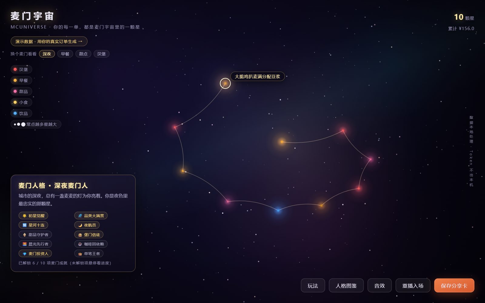
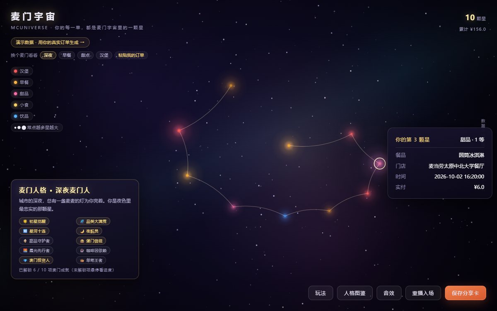
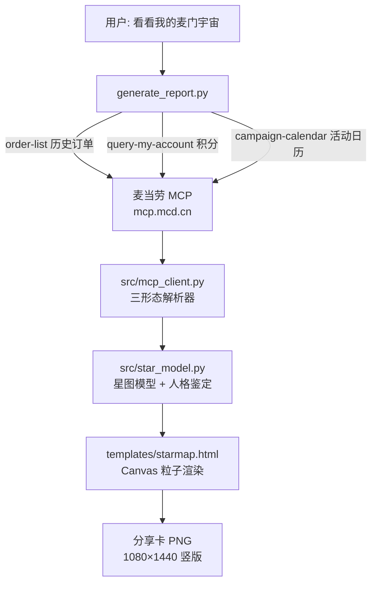

# 麦门宇宙 McUniverse

> 你的每一单，都是麦门宇宙里的一颗星。

基于麦当劳中国官方 MCP 开发的 Skill：拉取你的历史订单，生成个人「麦门星图」与「麦门人格」鉴定，一键导出分享卡。数据全程本地处理，Token 不出本机。

**麦当劳程序员创意开发大赛（WorkBuddy × 麦当劳 · 1024 程序员节）参赛作品**

[](https://github.com/TianWenzzzh/mcd-universe/actions/workflows/ci.yml)


## 在线演示

> 国内访问优先用镜像（杭州 ECS，实测 0.3s）：<http://47.114.38.125/mcd/demo/>；下面的 GitHub Pages 链接在国内可能等 30–90 秒。

[打开演示星图（无需登录）](https://tianwenzzzh.github.io/mcd-universe/demo/) —— 页面左上角可切换四种人格样例；也可直接打开
[早餐先行者](https://tianwenzzzh.github.io/mcd-universe/demo/breakfast.html) ·
[甜点星住民](https://tianwenzzzh.github.io/mcd-universe/demo/dessert.html) ·
[硬核堡星人](https://tianwenzzzh.github.io/mcd-universe/demo/burger.html) ·
[0 单星云态](https://tianwenzzzh.github.io/mcd-universe/demo/?nebula=1)

📄 [作品说明页](https://tianwenzzzh.github.io/mcd-universe/docs/about.html)（一页讲清玩法与技术）

✍️ [**用自己的订单生成**](https://tianwenzzzh.github.io/mcd-universe/demo/?open=import) —— 直达粘贴面板，不需要 Token、不需要装环境；手边没有订单文件就点面板里的「填入示例」，三单就能看出颜色、星等、星轨在讲什么。

⚡ **国内镜像**（杭州 ECS，实测快 5–13 倍）：<http://47.114.38.125/mcd/demo/> · [说明页](http://47.114.38.125/mcd/docs/about.html)


| 桌面端 | 移动端 | 星点详情 |
|---|---|---|
|  |  |  |

## 功能

- **麦门星图**：每一笔订单化为一颗星——颜色=餐品品类（汉堡/早餐/甜品/小食/饮品），星等=消费频次与金额，位置=下单时间，沿星系旋臂铺开并缓慢旋转。粒子汇聚「麦门宇宙」四字后炸开成星图；深空星场 460 颗背景星三层纵深、星云雾带、流星、暗角聚焦。
- **在线生成**：演示页可直接粘贴订单 JSON（MCP 原始返回 / 订单数组 / `{"list":[...]}`）生成自己的星图——纯前端解析，数据不出浏览器；与 Python 管线共用同一套规则，`tests/test_model_parity.py` 做逐字段交叉校验，防止两份实现漂移。`?open=import` 深链可直达面板，适合放进说明页与社媒文案。
- **首屏不黑屏**：Canvas 首帧前先显示内联的真实星图封面（15KB JPEG，零新增请求），首帧画完 0.28 秒淡出；关闭 JavaScript 时封面自动隐藏并显示明确提示。
- **可玩的交互**：悬停星点发光放大并显示餐品名、鼠标提灯视差、拖拽转动星系、滚轮拉近拉远、点击看订单详情、可选星语音效（环境音 + 悬停音阶）；触屏上自动换成「轻点看详情 / 单指转动 / 双指捏合缩放」；支持键盘操作（←/→ 逐颗浏览、Enter 看详情、± 缩放、Esc 关闭）与屏幕阅读器结构化清单。**订单详情卡跟着你点的那颗星走**：四个方向里挑一个既不压住那颗星、也不压住按钮区和其它 HUD 的位置；窄屏上改成从底部升起的抽屉，人格卡先让位，收起时再回来（转动或缩放星系会让卡片与星星错位，那时自动收起）。
- **麦门成就**：10 项成就（初星觉醒 / 品类大满贯 / 星河十连 / 夜航员 / 甜品守护者 / 堡门信徒 / 晨光先行者 / 咖啡因依赖 / 麦门投资人 / 单笔王者），依真实订单自动解锁，未解锁项悬停（触屏点按）看进度。
- **麦门人格 × 图鉴**：7 种正面向人格（深夜麦门人 / 早餐先行者 / 甜点星住民 / 周末麦门人 / 硬核堡星人 / 麦门探索者 / 麦门旅人）——鉴定你的人格，图鉴里全员亮相、你的那枚高亮。宇宙不只有深夜，每一种吃麦方式都有一颗星。
- **分享卡**：四种风格（深空金 / 星云紫 / 极简海报 / 成就卡）任选导出 1080×1440 竖版 PNG，带扫码入口与等比裁剪防变形。**交付路径按容器分流**：桌面与普通手机浏览器直接下载；微信内置浏览器与 iOS Safari 不实现 `a[download]`，自动改为「预览 + 长按保存」，提示文案也跟着换（微信里额外给出「换浏览器打开」的兜底），不会假装导出成功。版式集中在一份规格里（安全边距 48px、二维码与文案留 34px 气道、中文按句读断行不挂标点），四种画幅导出的是同一张卡。
- **积分哨兵**：积分余额与「下月过期」提醒，守住每一分。
- **今日麦签**：联动官方活动日历，每天一个麦麦活动彩蛋。
- **星云状态**：0 单账号不报错，输出「宇宙初开」——新用户也是有效用户。

## 快速开始

```bash
# 1. 申请麦当劳 MCP Token：https://open.mcd.cn/mcp （手机号登录 → 控制台 → 激活）
# 2. 配置环境变量（Token 只进环境变量，绝不写入任何文件）
export MCD_MCP_TOKEN="your_token_here"

# 3. 拉取本人订单，生成个人星图报告
python scripts/generate_report.py --live -o report.html

# 或用模拟数据生成演示报告
python scripts/generate_report.py --demo samples/demo_orders.json -o report.html
```

## 技术栈

Python（MCP 客户端 + 订单解析 + 星图模型 + 人格鉴定，78 条测试全绿）+ 单文件 HTML/Canvas（星图渲染，零依赖零外链，离线可用）。

## 工程细节

**核心洞察：取数交给 MCP，归类交给代码，表达交给 Canvas。**



`src/mcp_client.py` 处理了麦当劳 MCP 实测的四种返回形态：干净 JSON、文本包装内嵌 JSON、`[N]{列名}:` 文本表格、「JSON 里再套文本表格」的二层包装——错误响应还会在标记后先输出人话再跟 JSON，且业务错误 `isError=false` 但 `success=false`（如 query-order 非本人订单 610301），均已归一化并有测试覆盖。`scripts/lint_template.py` 对渲染模板做静态检查（未定义函数调用 / 缺失 DOM 引用），防住只在罕见路径暴露的崩溃。`scripts/check_links.py` 校验页面间的本地引用是否真的可达（`./` 与 `../` 写错会让评委点进 404）。`scripts/check_meta.py` 查的是链接被转发出去的那一刻：每个页面必须有 og/twitter/theme-color/favicon，og:image 必须是指向本仓库、JPG/WebP、≤200KB 的真实文件（说明页此前一份 og:meta 都没有，转进群里就是一张灰卡；演示页则指向过 1.45MB 的 PNG，抓取器经常直接丢掉）。`tests/test_mirror_assets.py` 反过来查镜像那头：页面引用的每一张图都必须在同步白名单里（`og-card.jpg` 曾漏在白名单外，镜像上一直 404 —— 五个页面的 `og:image` 全指向它，镜像链接转进微信就是灰卡），同时保证投稿用的大原图不会顺手被传上去。`scripts/layout_audit.mjs` 量说明页的截图版式：卡片内部空洞、同行卡片高度差、横向溢出，三档宽度各量一遍（旧版式在桌面上有两张卡片各空了 626px 和 288px）。`scripts/check_weight.py` 守住「单文件零依赖」这个承诺：每页字节预算 + 禁止任何指向外部主机的 script/link/img，加一个 CDN 字体就会红。`scripts/e2e_check.mjs` 用真实浏览器跑十态冒烟（深链导入 / 银河 / 星云 / 甜点 / 减少动效 / 触屏 390×844 / 小屏 360×640 / 微信内置浏览器 / iOS Safari / 安卓系统浏览器）并校验分享卡导出产物、移动端 HUD 不重叠、触屏文案不含鼠标动作、双指捏合真的会缩放、以及星点在任何旋转角度下都不钻到 HUD 底下；交付路径单独验——同一台安卓手机上，微信里必须弹「长按保存」、系统浏览器里必须真的触发下载，面板提示不许承诺一个不会发生的下载；三层浮层（首访引导 / 分享卡预览 / 导出面板）都必须是真模态（role、焦点进入、Tab 循环、Esc 关闭）；分享卡版式另有一组几何断言（安全边距、二维码与文案不重叠、文案断行不超版心且不挂行首标点）读的是 `cardLayout()` 规格本身，不靠像素；详情卡落点也在三档屏幕 × 全部星点上真点一遍（30 次）——盖住刚点的那颗星、压住按钮或任何 HUD、越出屏幕都算失败（`tests/test_detail_placement.py` 是同一条约定在无浏览器 CI 里的静态守卫）。`scripts/card_audit.mjs` 是分享卡的像素体检：按行统计"墨量"，找出缩略图里才显形的空洞带与贴边。`scripts/perf_check.mjs` 是性能体检：手机 4× CPU 降速与桌面两档，量每帧主线程耗时、每帧 canvas 绘制调用数（arc / fill / stroke / 新建渐变）、每帧 DOM 几何读取、堆增长、分享卡导出耗时与页面重量。CI 覆盖 Python 3.10–3.13 四个版本 + ruff + pytest + 模板检查 + 链接检查 + 社交元信息检查 + 页面重量检查。详见 [MCP_INTEGRATION.md](MCP_INTEGRATION.md) 与 [CONTRIBUTING.md](CONTRIBUTING.md)。

## 性能

星图是每帧重绘的 Canvas 场景，所以性能不是"跑得动就行"，而是有预算的：每帧只有 16.7ms（60fps）。手机档在 4 倍 CPU 降速下实测：

| 指标 | 开场（上千颗粒子拼字） | 稳态（星图 + 星轨 + 流星） |
|---|---|---|
| 每帧主线程耗时 | 1.0ms（p95 1.8） | 0.4ms（p95 1.0） |
| 每帧 arc / 新建渐变 | 721 / 0.2 | 21 / 0 |
| 每帧 DOM 几何读取 | 0 | 0 |

首屏 98ms（桌面）/ 451ms（手机 4× 降速），页面 100KB，外部请求 0，8 秒稳态堆增长 0MB。帧耗时这类数字会随机器负载浮动（同一份代码在本机 0.4~1.5ms 之间），所以真正的判据是 `perf_check.mjs` 的预算线，而不是某一次的绝对值。曾经的两个真实开销：星轨连线每段新建一个线性渐变（10 颗星 = 每帧 10 个渐变 + 10 次描边，渐变亮端还正好被星点盖住），以及每颗粒子每帧 new 一个 `{x,y}` 临时对象——都改成一条路径一次描边 / 标量运算后，稳态每帧渐变 10 → 0（只有流星偶尔新建一个）。改动前后用固定随机种子做过像素比对（全图平均差 0.032/255），视觉上没有损失。

## 目录结构

```
├── SKILL.md                  # Skill 定义
├── src/                      # MCP 客户端、星图数据模型、人格鉴定
├── templates/                # 星图 HTML 报告模板（Canvas 渲染）
├── scripts/                  # 数据拉取、报告生成、演示页重建、模板/链接/元信息/重量检查、版式与卡片体检、E2E、性能体检、截图与 GIF
├── samples/                  # 演示数据（匿名化）与官方营养数据
├── tests/                    # 测试（先证伪再交付）
├── demo/                     # 在线演示页
├── docs/assets/              # GIF 与截图资产
├── .github/workflows/        # CI（测试 + 模板/链接/元信息/重量检查）
├── CONTEST_DECLARATION.md    # 参赛声明
├── CONTRIBUTING.md           # 贡献指南
├── CHANGELOG.md              # 变更日志
├── pyproject.toml            # 项目元数据 / ruff / pytest 配置
├── MCP_INTEGRATION.md        # MCP 集成说明
├── mcp-config.example.json   # 脱敏配置示例
├── workbuddy.md              # WorkBuddy 开发记录
└── LICENSE                   # MIT
```

## 安全承诺

Token 只从环境变量读取；订单数据仅本地处理，不上传不留存；`.gitignore` 已排除一切本地个人数据。
